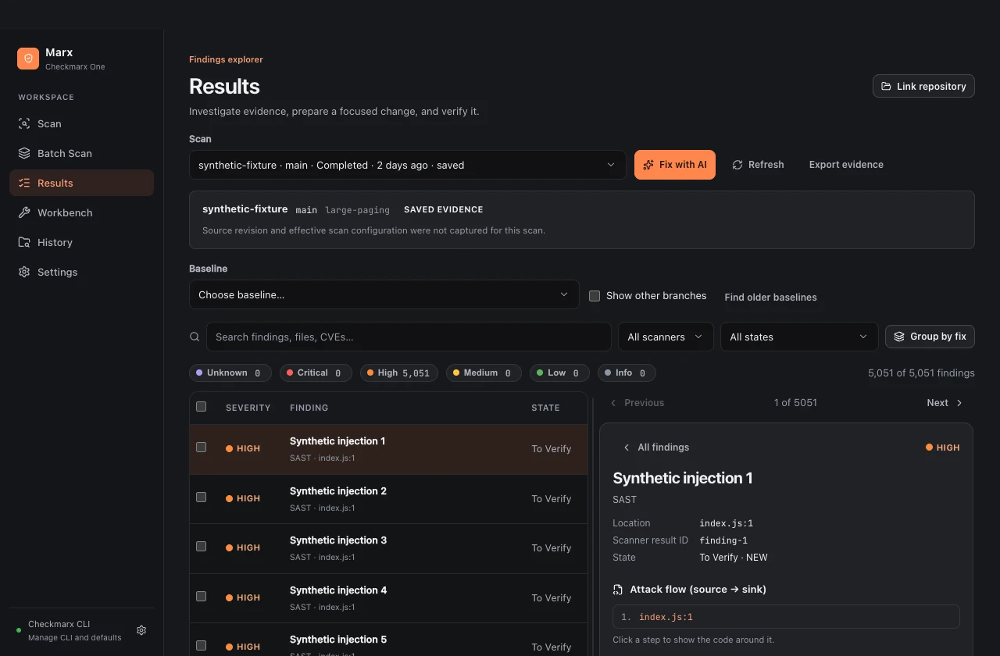

# Marx

A desktop workbench for investigating and remediating Checkmarx One findings.


[](LICENSE)

[Walkthrough](docs/walkthrough.md) · [Product website](https://aaarslan.github.io/marx/) · [Showcase video](website/assets/marx-showcase.mp4) · [Documentation](docs/README.md) · [Contributing](CONTRIBUTING.md)



Marx runs your installed, official Checkmarx CLI through a graphical workflow. The CLI uploads selected source to Checkmarx One for remote analysis. Marx is an independent project and requires your organization's Checkmarx access and approved CLI.

## What you can do

- Configure SAST and SCA scans with explicit folder-to-project mappings and per-project options.
- Monitor durable jobs, recover known scans after restart, and retain uncertain submission outcomes without automatic resubmission.
- Filter and investigate findings, inspect source flows, group related fixes, and compare selected baselines.
- Enrich explicit CVE findings with opt-in CISA KEV, FIRST EPSS and CVE.org context, while preserving scanner severity.
- Revisit scoped decisions when exploitation evidence changes, with pinned history and review dates.
- Prepare local prompts for your coding assistant, pin original evidence, and record changes and verification results.
- Scan workspace packages and export CSV, JSON, official SARIF, or remediation evidence bundles.

The screenshots and film use synthetic data from the native application. Prompt generation stays local; Marx does not call a model or modify your repository.

## Get started

Published installer downloads are not available yet. Build locally using Go 1.27.3 and Bun 1.4.4. macOS builds require Xcode Command Line Tools; Windows requires WebView2, and installer creation requires NSIS 3.12.

```sh
bun install --frozen-lockfile
bun run build
bun run start
```

The build selects the host platform. Outputs are `dist/Marx.app` on macOS and `dist/Marx.exe` on Windows. Use `bun run dist:win` on Windows to create the per-user installer. See [building and verification](docs/building.md) for exact platform commands and toolchain setup.

1. Open **Settings**, select the official CLI and optional configuration file, and test the connection. Existing CLI authentication is the default.
2. Choose a source folder, confirm its Checkmarx project, and review the scan options before upload.
3. Open **Results** to investigate findings, prepare a handoff, or track remediation in **Workbench**.

Command+O / Ctrl+O selects a folder. Command+R / Ctrl+R starts the configured scan. Follow [the walkthrough](docs/walkthrough.md) for the complete workflow.

## Platform and security status

Marx uses Wails 3.1.0, Go, SQLite and React with the system webview. No Bun, Node or Electron runtime is distributed.

| Platform | Current status |
| --- | --- |
| macOS Apple Silicon | Native synthetic workflow and locally built app verified; ad hoc signed, without notarization |
| Windows 11 x64 | Prior revision passed native synthetic acceptance, race checks and install/uninstall; new CVE controls need final native validation |

Linux, Intel macOS and Windows ARM64 are outside the supported targets. Windows packages are unsigned. Synthetic checks do not establish live tenant acceptance. See the [final acceptance checklist](docs/final-acceptance.md) before merging.

Optional saved keys use Windows DPAPI or macOS Keychain-backed encryption. Local evidence and exports can contain sensitive information; the SQLite database is not encrypted. Public intelligence lookups are optional and send only CVE IDs where required. Marx has no analytics service. The Wails child-frame bridge boundary remains documented alongside application mitigations in [SECURITY.md](SECURITY.md).

## Development

```sh
bun run typecheck
bun run test --pool=threads --maxWorkers=2
bun run test:go
bun run verify:site
bun run audit
```

[Contributing](CONTRIBUTING.md) covers native acceptance, packaging, privacy checks and project conventions. Keep real scan data and credentials out of issues and pull requests; use [private security reporting](SECURITY.md) for vulnerabilities.

## License

Marx is [MIT licensed](LICENSE). Checkmarx services and the official CLI have their own licensing. See [CVE intelligence](docs/cve-intelligence.md), [third-party notices](THIRD_PARTY_NOTICES.md), [dependency maintenance](docs/dependencies.md) and [showcase sources](showcase/README.md) for tooling and media details.
