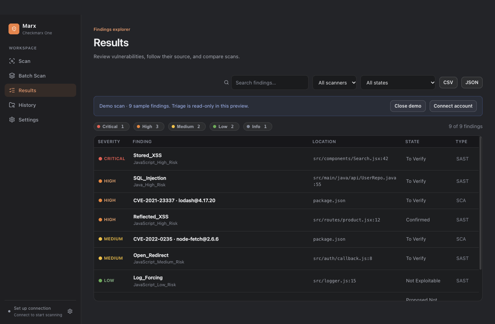

<div align="center">
  

# Marx

**A desktop client for Checkmarx One.**

Scan local projects with SAST and SCA, explore findings, and compare changes before you push.


[](LICENSE)

[Features](#features) · [Quick start](#quick-start) · [Development](#development) · [Security](SECURITY.md) · [Changelog](CHANGELOG.md)



<sub>The screenshot uses built-in sample findings, not a customer scan.</sub>
</div>

## Features

| Workflow | What Marx provides |
| --- | --- |
| Scan a project | Browse or drop a folder, detect its Git branch, choose SAST/SCA options and exclusions |
| Follow progress | CLI submission, queue and scan progress with live output, cancellation and completion notifications |
| Explore findings | Severity, scanner and state filters; search; attack flows and local source snippets |
| Compare changes | Scan-to-scan diff and a story-check verdict for new High/Critical findings |
| Triage and export | Update result states with a comment; export filtered findings as CSV or JSON |
| Scan multiple projects | Discover subprojects and run a bounded batch queue with per-project status |
| Work comfortably | Keyboard navigation, recent folders, reduced-motion and display accessibility support |

Marx is a standalone GUI for the official Checkmarx One `cx` CLI. It runs your installed CLI for authentication, project discovery, scan submission, monitoring, results and triage. The CLI uploads selected source and analysis runs in Checkmarx One. Marx has no custom upload fallback.

## Quick start

### Requirements

- macOS on Apple Silicon, or Windows x64/ARM64. Windows packages are cross-built; native Windows runtime validation is still pending.
- Your organization’s approved Checkmarx One CLI (`cx`), installed and configured. CLI 2.3.69 is the locally checked contract baseline.
- A Checkmarx One account authorized to run scans. Existing CLI authentication works without saving a second API key in Marx.
- [Bun](https://bun.com/) 1.4.4 to run or package the source.
- Git is optional for branch detection.

Clone this repository, enter its directory, then run:

```sh
bun install --frozen-lockfile
bun run dev
```

1. Open **Settings**, select the same **CLI executable** that works in your terminal (or leave it blank for PATH discovery), keep **Use the CLI’s existing configuration**, and choose **Test CLI connection**. If your command uses a custom configuration file, enter its absolute path. Alternatively, choose **Use an API key saved in Marx**, save your key and connection settings, then test the CLI connection.
2. Open **Scan** and choose a project folder. Check the detected branch, project and exclusions.
3. Choose the exact Checkmarx project. **Run scan** saves the repository mapping and starts the scan. **Story check** runs a full scan and opens Results, where you choose a baseline explicitly.
4. Open **Results** to inspect, compare, triage or export findings.

**Try it without credentials:** open Results and choose **Load demo results**. Sample findings use the normal filters and detail view; demo triage is read-only.

### Build an app

```sh
bun run dist:mac        # macOS ARM64 DMG and ZIP
bun run dist:win        # Windows x64 installer
bun run dist:win:arm64  # Windows ARM64 installer
```

Artifacts appear in `dist/`. On macOS, open the DMG and copy **Marx.app** to Applications. On Windows, run the installer. Bun is not needed to run a packaged app. See [building and packaging](docs/building.md) for host requirements and validation boundaries.

macOS builds are ad-hoc signed and are not notarized. macOS may require approval in **System Settings → Privacy & Security** before the first launch. Only approve a build you produced or otherwise trust.

Windows installers are unsigned. Windows may display an unknown-publisher or SmartScreen warning; use only builds you trust.

### Keyboard shortcuts

| macOS | Windows | Action |
| --- | --- | --- |
| `⌘O` | `Ctrl+O` | Choose a project folder |
| `⌘R` | `Ctrl+R` | Run scan; returns to the Scan view |
| `⌘⇧R` | `Ctrl+Shift+R` | Reload the window |
| `Esc` | `Esc` | Return from a finding to the results list |

## Fix findings with your coding assistant

In **Results**, choose **Fix with AI**. Select exact severity levels (Critical and High are selected initially), choose all loaded findings, the current results filters, or the finding you are inspecting, and preview the prompt. Choose **Copy prompt** and paste into Copilot with the affected repository open. **Other coding assistant** provides a provider-neutral template.

Prompts include finding identities, CVE/CWE references, dependency versions and recommendations, triage state, locations and full SAST flows. Large selections become numbered batches with independent context. Copy each batch or save all batches as Markdown. Incomplete scans and demo evidence remain clearly labeled.

Prompt generation is local and requires no LLM API key. Marx does not send prompts to an assistant or apply fixes automatically. Your coding assistant makes changes in your repository; use a fresh Marx scan to confirm the outcome. See [remediation prompts](docs/remediation-prompts.md) for the format and template extension point.

## How it works

```text
Marx controls → official cx CLI → Checkmarx One scan
                    ↓                    ↓
                live output       CLI status and reports
                                         ↓
                               Marx findings and comparison
```

Default exclusions omit `.git`, `node_modules` and common build output. Review exclusions before scanning; they can be customized. The CLI handles source packaging and upload. Marx reads JSON reports from a private temporary directory and removes those reports after reading them. Exclusions are translated into CLI filters; default exclusions can be removed explicitly with `!name`.

The **Story check** runs a full scan of the working folder, including uncommitted files. In Results, explicitly select an earlier completed scan of the same project as the baseline. Candidates default to the same branch; enable **Show other branches** to compare across branches deliberately. Its default gate flags new High/Critical findings. Incomplete results do not produce a verdict. These comparisons describe finding changes; they do not establish exploitability or remediation correctness.

See [CLI contracts](docs/api-contracts.md) for command and report formats and [limitations](docs/limitations.md) for current boundaries.

## Scan safeguards

Before authentication in the connection test and before every scan submission, Marx checks local CLI help for required commands and flags. Unsupported capabilities produce an actionable error before upload. This verifies command availability, not tenant permissions or server compatibility.

Repository mappings use the canonical folder path, exact project ID and a fingerprint of CLI configuration and environment. Changed configuration requires confirming the mapping again. Folder names never select existing projects or source folders. Batch scans reuse saved mappings; unbound folders create new projects, and existing names are blocked until explicitly mapped in Scan. The CLI resolves the selected name back to its expected ID before submission.

## Privacy and credentials

The official CLI sends source archives and the metadata needed to run a scan to your Checkmarx One tenant and its upload endpoint. Marx does not include analytics or a separate application backend.

Settings and the credential file live in Electron’s per-user application-data directory. When Marx-managed authentication is selected, the saved key is passed only in the child process environment, never in command arguments. Marx does not modify the CLI’s existing credential configuration. Marx-managed keys require Electron `safeStorage` encryption backed by macOS Keychain or Windows DPAPI. If protected storage is unavailable, saving and reading keys is blocked; use native CLI authentication. Legacy plaintext or unreadable keys remain untouched until you explicitly replace or remove them in Settings. See [Security](SECURITY.md) for details.

## Development

The app uses Electron, React, TypeScript and Zustand. Bun handles installation, scripts, tests, typechecking and packaging; Electron retains its own embedded Node.js runtime.

| Command | Purpose |
| --- | --- |
| `bun run dev` | Launch the development app |
| `bun run typecheck` | Check main/preload and renderer TypeScript projects |
| `bun run test` | Run the local Vitest suite |
| `bun run build` | Remove previous `dist/` artifacts and compile the application |
| `bun run start` | Preview an existing build |
| `bun run clean:dist` | Remove all distribution artifacts |
| `bun run dist` | Package for the current host platform |
| `bun run dist:dir` | Build an unpacked app for the current host |
| `bun run dist:mac` | Build the ad-hoc-signed macOS ARM64 DMG and ZIP |
| `bun run dist:win` | Build a Windows x64 installer |
| `bun run dist:win:arm64` | Build a Windows ARM64 installer |
| `bun run dist:win:dir` | Build an unpacked Windows x64 app |
| `bun run screenshot` | Capture the real demo UI with a disposable profile |
| `bun run audit` | Check dependencies for known security advisories |

Every build removes the entire previous `dist/` directory before compilation, including installers and unpacked apps for other platforms. All packaging commands inherit this cleanup, so only artifacts from the latest packaging run remain. Verification and screenshot commands also call `build` and clear `dist/`. Source files, configuration and installed applications are unaffected.

```text
src/main/           Electron lifecycle, IPC, scan runners and CLI adapter
src/preload/        Typed, isolated renderer bridge
src/renderer/       React views and shared UI
src/shared/         Models, IPC contracts and verdict rules
tests/              Local unit and regression tests
scripts/            Packaging, screenshots and icon generation
```

Use `MARX_USER_DATA_DIR` with a disposable directory for isolated runtime checks. Do not copy real credentials into test profiles.

Verification is local. No GitHub Actions or other CI configuration is included. [Contributing](CONTRIBUTING.md) describes the checks to run before a pull request.

## Project status

Marx is a young application. Local tests cover CLI arguments, process execution and limits, credential forwarding, reports, normalization, pagination, cancellation, project selection safety, source access, exports and verdicts. `bun run verify:cli` exercises the Electron GUI with an isolated synthetic CLI and no network calls. Live tenant workflows still require end-to-end validation with a real API key. A passing test suite is not proof of every tenant integration or an absence of vulnerabilities.

See [current limitations and validation gaps](docs/limitations.md).

## Acknowledgments

Built with [Electron](https://www.electronjs.org/), [React](https://react.dev/), [electron-vite](https://electron-vite.org/), [Zustand](https://zustand.docs.pmnd.rs/), [Archiver](https://www.archiverjs.com/) and [Lucide](https://lucide.dev/). CLI contract research used the official [Checkmarx AST CLI](https://github.com/Checkmarx/ast-cli) source. Interaction refinements were informed by [Emil Kowalski's design engineering skills](https://github.com/emilkowalski/skills).

## License

[MIT](LICENSE) © Marx contributors.

Marx is an independent project and is not affiliated with or endorsed by Checkmarx. Checkmarx is a trademark of its respective owner.
