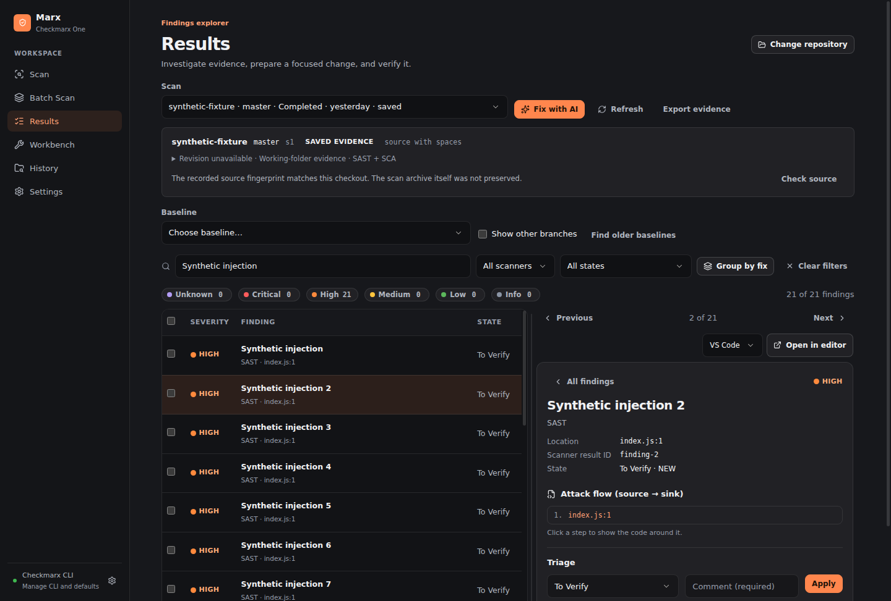

# Marx

A desktop remediation workbench for Checkmarx One.


[](LICENSE)

This branch uses Wails 3.0.0 with the installed WebView2 runtime, Go for native desktop integration, and a compiled Bun sidecar for the existing scan/workbench engine and SQLite. Electron is not shipped. Windows 11 x64 is the verified target.



This screenshot contains synthetic findings from the earlier Electron version; it is not new Wails verification evidence.

## Features

| Workflow | What Marx provides |
| --- | --- |
| Scan a project | Browse or drop a folder, detect its Git branch, choose SAST/SCA options and exclusions |
| Follow progress | Durable jobs and logs, recovery of known scans after restart, confirmed cancellation and explicit unknown outcomes |
| Explore findings | Saved filters and investigation context, paged split list/detail, related-fix groups, source freshness and editor links |
| Compare changes | New, persistent, escalated, reduced and absent findings with explicit coverage and provenance checks |
| Track remediation | Pinned baseline evidence, exact finding selections, assistant handoffs, change references, checks and verification records |
| Triage and export | Update states with a comment; export filtered CSV/JSON, official SARIF or a complete remediation evidence bundle |
| Scan multiple projects | Nested workspace discovery, dependency impact hints, exact per-folder project mappings and custom scan options |
| Work comfortably | Keyboard navigation, recent folders, reduced-motion and display accessibility support |

Marx is a standalone GUI for the official Checkmarx One `cx` CLI. It runs your installed CLI for authentication, project discovery, scan submission, monitoring, results and triage. The CLI uploads selected source and analysis runs in Checkmarx One. Marx has no custom upload fallback.

## Quick start

Install the Windows x64 package built from this branch. End users need WebView2 and their organization's approved Checkmarx CLI (`cx`); Go, Bun and Node do not need to be installed.

1. Open Settings, select the official CLI executable and optional configuration file, and test the connection. Existing CLI authentication is the default.
2. Select a source folder and confirm its Checkmarx project mapping. Review scanner options before submitting.
3. Monitor the job and investigate Results. Baselines are explicitly selected; uncertain submissions are never automatically retried.
4. Select findings to generate AI handoffs or track remediation. Export CSV, JSON, official SARIF, and pinned evidence bundles.

Ctrl+O selects a folder; Ctrl+R starts the configured scan. Native folder drop is enabled. External links open in the system browser.

## Build and verify

Use Go 1.27.3, Bun 1.4.4, the pinned Wails 3.0.0 module, and NSIS 3.12 for the installer. See [building](docs/building.md) for prerequisite setup and runtime verification.

```powershell
bun install --frozen-lockfile
bun run typecheck
bun run test --pool=threads --maxWorkers=2
bun run build
go test ./native ./tools/resources
bun run audit
govulncheck ./native ./tools/resources
bun run dist:win
```

Output: `dist/Marx.exe`, `dist/marx-core.exe`, and `dist/Marx-0.9.0-win-x64-setup.exe`. Keep both executables together. The per-user installer uses a separate `MarxWails` destination and retains data on uninstall. Electron credentials and settings are not imported.

## Security and validation

The official CLI uploads selected source for Checkmarx One analysis. Marx stores evidence locally; the SQLite database is not encrypted. Optional saved credentials use Windows DPAPI. Protect exports and backups. There is no analytics service.

Wails 3.0.0 has a documented child-frame/native-bridge limitation. Marx blocks embedded frames and remote content; these protections do not fix the upstream framework. Read [SECURITY.md](SECURITY.md), [dependencies](docs/dependencies.md), [migration coverage](docs/wails-migration.md), and [limitations](docs/limitations.md).

Synthetic checks do not establish live tenant acceptance. Installers are unsigned. Other platforms and architectures are not qualified on this branch.

Built with [Wails](https://wails.io/), [Go](https://go.dev/), [Bun](https://bun.com/), [React](https://react.dev/), [Vite](https://vite.dev/), [Zustand](https://zustand.docs.pmnd.rs/), SQLite, and [Lucide](https://lucide.dev/).
