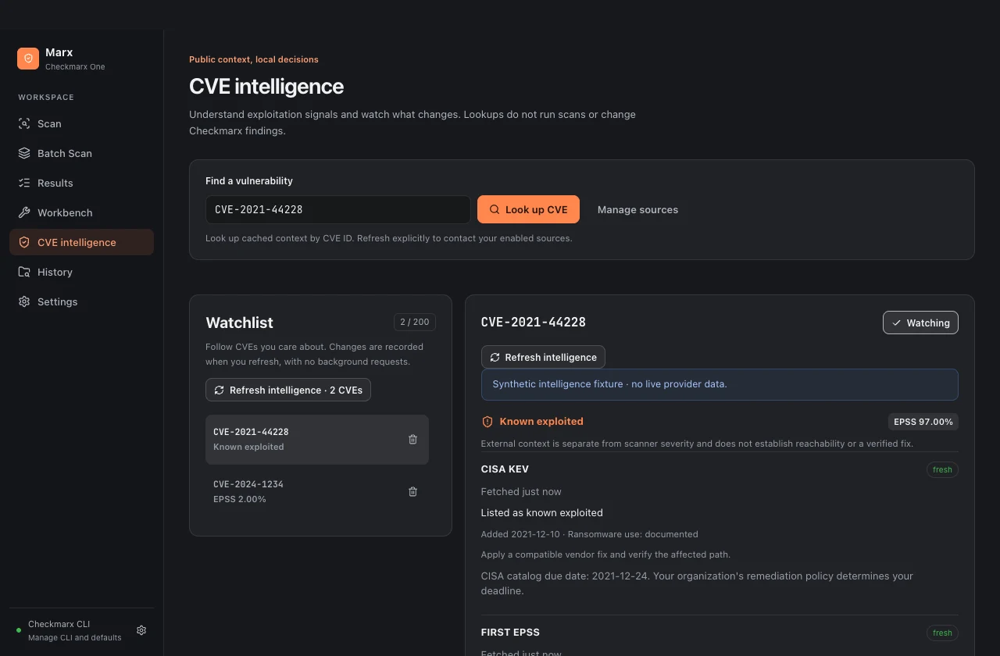
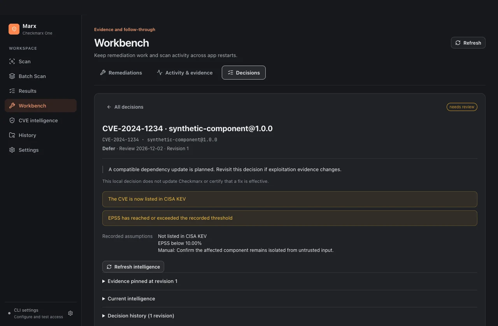

# CVE intelligence and decision reviews

Marx combines Checkmarx finding evidence with optional public CVE context. Scanner severity, exploitation signals and your local decisions stay separate. A high probability or a public exploit reference does not establish reachability in your repository; an unavailable score does not establish safety.

## Enable sources deliberately

Open **Settings → Public CVE intelligence**, select sources, and choose **Save intelligence preferences**. All sources are disabled initially. Saving a preference makes no lookup; use **Refresh intelligence** in Results or the intelligence view when ready.

| Source | What it supplies | What leaves your computer |
| --- | --- | --- |
| CISA KEV | Complete known-exploited catalog from CISA's official GitHub mirror, listing dates, required action and documented ransomware use | A request for the public catalog; no finding identifiers |
| FIRST EPSS | Published 30-day exploitation probability, percentile and score date | The CVE IDs you request |
| CVE.org | Publication state, CNA/CISA CVSS scores, available published SSVC context and reference tags | The CVE IDs you request |

Marx sends no repository files, source snippets, paths, package inventory, tenant identifiers or Checkmarx credentials to these providers. HTTPS requests use the system trust store and normal proxy environment configuration. There are no intelligence API keys, paid fallbacks, arbitrary provider URLs, background refreshes or model calls. Opening a reference is an explicit action through your browser.

Sources have separate terms: [CISA's mirror](https://github.com/cisagov/kev-data), [FIRST EPSS data](https://www.first.org/epss/data) and [CVE Program terms](https://www.cve.org/Legal/TermsOfUse). Source attribution remains attached to observations. Marx does not distribute bulk feeds in the application.

## Investigate a finding

In **Results**, open a finding with an explicit CVE ID and expand **CVE intelligence**. Marx does not infer a CVE from a CWE or a finding title. Refresh the finding, or refresh all CVEs in the loaded scan. The scan action deduplicates CVE IDs, reports progress and supports cancellation.

- **Known exploited** means a positive CISA listing. Cached positive evidence stays visible with its freshness qualifier.
- **EPSS** is a probability, not CVSS severity. Percentile is shown separately. A published zero remains a zero; missing data stays unavailable.
- **CVE scores** name the scorer and scoring version. Differences from Checkmarx prompt review rather than overwriting its score.
- **SSVC context** is the assessment published in the CVE record, when present. Marx does not infer your organization's exposure or operational impact.
- **Exploit references** are links tagged by the CVE record provider. They are not independently validated exploit code. Marx never downloads or executes their contents.

Use the **Intelligence filter** to show KEV evidence, fresh EPSS of at least 10%, or findings with no current intelligence. The 10% filter is a browsing aid, not a universal remediation deadline. CISA's catalog due dates describe its published requirements; your organization determines its applicable obligations and policy.



## Watch observed changes

Open **CVE intelligence** to look up an exact CVE ID and maintain a local watchlist. **Watch CVE** is also available in a finding. In the intelligence view, **Watching** confirms a saved watch; choose it again to stop watching. The first observation establishes a silent baseline. Later explicit refreshes record newly observed KEV listings, changes in EPSS and newly rejected CVE records. These are differences between your local observations, not a complete external threat timeline.

Cached context remains readable offline. Each source displays fresh, stale, unavailable, disabled or not checked independently. A failed refresh retains earlier observations with an error; it does not replace them with negative answers. Disabling a source cancels the active refresh. **Clear fetched cache** removes mutable lookup data while preserving decision evidence, session evidence and watch history.

## Record and revisit a decision

In a finding, choose **Record decision**. Select Patch now, Defer, Accept risk, Not affected or Mitigated; provide a rationale and review date. You may record a manual assumption and, when fresh evidence supports it, assumptions that the CVE remains outside KEV or below an EPSS threshold.

Decisions are scoped to the Checkmarx connection, project, finding and exact package version. A connection change or concurrent revision blocks a stale save. Recording a local verdict never changes a Checkmarx result state, marks a scan verified, or certifies non-exploitability.

In **Workbench → Decisions**, inspect the current review state:

- **Active:** no recorded assumption is currently broken and the review date has not arrived. This is not a safety assessment.
- **Needs review:** an observed fact contradicted an assumption, or the CVE became rejected. The triggering evidence is retained. The flag stays until you explicitly revise or close the decision, even if later data changes again or the fetched cache is cleared.
- **Unavailable:** an assumption cannot currently be rechecked with fresh evidence. It has not been silently validated.
- **Review due:** the recorded review date has arrived.
- **Closed:** you explicitly closed the local decision with a reason. Closure does not prove a fix.

Record a revised decision after reviewing new evidence. Earlier revisions retain their rationale, assumptions and pinned intelligence. Each revision can display both its original evidence and the observation that prompted review.



## Handoffs and exports

Local assistant prompts attach cached intelligence for the selected CVEs, including source and freshness qualifiers. Prompt generation makes no network request and warns if cached context cannot be attached. Finding text, notes and links remain untrusted evidence rather than instructions to an assistant.

JSON finding exports include current cached intelligence. Remediation sessions pin available intelligence when they are created. Their evidence bundle keeps `intelligence` as that original snapshot and `currentIntelligence` as a separate current observation; refresh does not replace the original. Older sessions can have no pinned intelligence. CSV and official SARIF retain their scanner formats.

**Export decisions** writes a local JSON archive containing scoped decisions, revision history and retained review-trigger evidence. This archive is not a VEX attestation. Notes, findings and exports can contain sensitive project information. The local SQLite evidence database is protected by existing profile permissions and is not encrypted by Marx.

## Bounds and verification

The service admits one refresh operation at a time, with up to 50 unique CVEs per bridge call and three concurrent CVE requests. The interface uses batches of 20, reuses the catalog during a scan refresh, accepts up to 5,000 CVEs per action and cancels a refresh after ten minutes. Each native call has a 90-second budget and each HTTP request a 15-second timeout. Only transient HTTP 429/502/503/504 responses receive one bounded retry; long server retry guidance is surfaced instead of ignored. Redirects are rejected.

Response limits are 8 MiB for the catalog, 1 MiB for an EPSS batch and 2 MiB for a CVE record. Catalog counts, identities and dates are validated before accepting negative membership. EPSS responses must match their requested IDs and reported totals; probabilities, percentiles and dates are checked. Publication date constrains EPSS freshness. Cache lifetimes are six hours for KEV, one hour for EPSS and 24 hours for CVE records.

The fetched cache retains the latest 5,000 CVEs. The watchlist holds 200 CVEs; 200 change events are retained and the latest 100 are shown. The ledger holds at most 1,000 scoped decisions and 100 explicit revisions per decision. A limit is reported rather than silently discarding decision history. Decision archives are limited to 32 MiB.

Normal tests use deterministic HTTP transports and require no external service. Native acceptance uses a separate, visibly synthetic provider transport compiled only into acceptance-tagged binaries. The production packaging verifier rejects that adapter. To explicitly check the real public providers with one known public CVE:

```sh
MARX_VERIFY_PUBLIC_INTEL=1 go test -tags integration ./native/engine -run '^TestPublicCVEIntelligenceSources$' -count=1 -timeout=2m
```

This is a public-data smoke check, separate from Checkmarx tenant acceptance. See [building and native verification](building.md) for platform checks.

The CVE intelligence and decision workflow was informed by [CVE Intel](https://github.com/Fazmin/cve-intel/tree/ca0ebf6c12a427bfd5571aff0fa5546207588234). Marx implements its Go/React integration without a Rust/Tauri runtime or a replacement scanner. See [third-party notices](../THIRD_PARTY_NOTICES.md).
