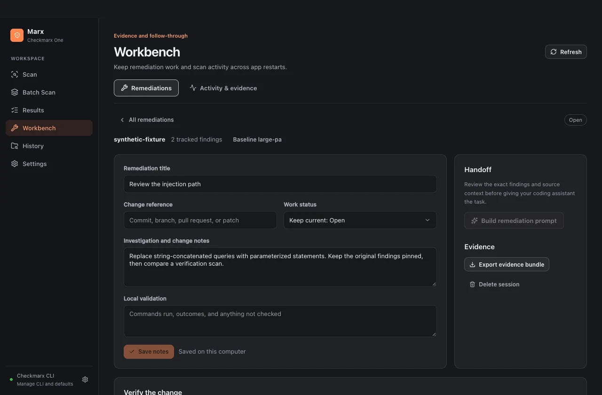

# Remediation workbench

Marx keeps an investigation, the proposed change, and later scan evidence together on the same computer. The official Checkmarx CLI still handles authentication, scanning and triage. The workbench does not call a model, edit a repository or submit a pull request on your behalf.

## Investigate and select

Open a scan from History or saved evidence in Workbench. Results remembers the scan's filters, chosen baseline, selected finding, list scroll position and split width. The list displays up to 100 rows per page; filtering, grouping and exports use the complete imported finding set. Use Alt+Up/Down or Previous/Next to move within the current review. The split divider supports arrow keys, Home and End.

**Group by fix** brings related evidence together without deleting occurrences:

- SCA groups share a package, manager, current version, and dependency/manifest context. Individual advisory recommendations are preserved; review them before choosing an upgrade. Different parent contexts remain separate.
- SAST groups require a matching rule and actual shared sink evidence. Similar titles alone do not establish one fix.
- Vendor redundancy is retained as an advisory hint. Every original finding ID remains available in its group and handoff.

The current source checkout can be checked against the fingerprint recorded before submission. A mismatch warns that locations may have moved. A matching fingerprint is not an archived copy of the uploaded source. Editor links use only a selected folder with a matching project binding and a validated in-folder source path.

## Track a remediation

1. Select findings or inspect a fix group, then choose **Fix with AI**.
2. Review the severity scope and generated batches. Choose **Track remediation** to create a named session with those exact findings.
3. In **Workbench → Remediations**, record notes, the commit or PR reference, and checks performed. These are your records; Marx does not execute the checks or independently validate the reference.
4. Copy or save the assistant handoff and apply the reviewed change in your normal development workflow.
5. Run a verification scan using recorded options, or select a later completed scan from the same project. Choose **Compare evidence** when its results are available.
6. Export the session's JSON evidence bundle when you need a portable record.

Creating a session atomically saves its metadata and a separate original scan snapshot. Later refreshes and triage changes update the normal result cache, not that baseline. Verification saves the later snapshot and the comparison record together. Editing a session cannot manually set it to Verified.

This screenshot uses synthetic fixture findings and no customer source or tenant.

## Verification

A comparison reports observed new, persistent, escalated, reduced and absent findings. It also reports why the evidence is comparable, incompatible or inconclusive. New or escalated High/Critical findings require attention even when coverage remains uncertain. Informational findings count toward the total; unknown severities remain Unknown and block a passing result.

A session reaches Verified only when all of the following are established:

- The verification scan is later, completed, from the same connection and project, and contains the complete supported finding set.
- Stable scanner identities support an unambiguous comparison. Duplicate or missing identities remain uncertain.
- Requested settings, successfully completed engines, effective server configuration and source scope are compatible.
- Every selected baseline finding is absent, and no new or escalated High/Critical finding violates the comparison gate.

For SCA, changing a package's version does not resolve a selected finding if the same package/CVE remains in the later scan. Missing package metadata is treated conservatively. A result state such as Not Exploitable is preserved as triage evidence; it does not make a finding disappear.

**Current boundary:** the checked CLI's ordinary scan view does not establish all effective server configuration and per-engine coverage. Capturing local requested options is insufficient to prove those facts. Working-folder scans also do not preserve an immutable upload archive or establish that source stayed unchanged throughout packaging. These comparisons remain inconclusive rather than receiving a green pass. The observed changes, reasons, selected-target outcomes and original/later evidence are still retained. Imported historical scans without local provenance have the same qualification limits.

Source fingerprints include Git-visible tracked and untracked nonignored files, with explicit limits of 20,000 files, 16 MiB per file and 256 MiB in aggregate. Non-Git folders use a bounded traversal. Missing fingerprints and capture warnings remain visible; fingerprints are not a guarantee of the CLI's exact packaged file set.

## Workspace batch planning

Batch reads npm/Yarn `workspaces` and pnpm's block-list `packages` declarations, including nested paths and bounded glob expansion. It also recognizes immediate child projects using common language manifests. It skips symlinked folders, hidden folders and build/dependency directories, and checks canonical containment. Unsupported patterns and discovery limits produce visible warnings.

Each row selects an exact existing Checkmarx project ID or an explicit new project name. Starting the batch saves those chosen mappings. Shared scanner options can be overridden per row; each folder uses its detected Git branch. A batch supports 1–200 selected projects and at most eight parallel scans. Initial jobs are committed together before any submission begins.

Affected-package suggestions consider uncommitted tracked/untracked Git changes and transitive dependencies declared between discovered JavaScript packages. A root/shared-file change selects every project conservatively. This is not a build-system dependency graph or a comparison against a chosen upstream branch, and it never silently submits only the suggestion. Check the selection yourself.

Each batch item uploads its own folder. Shared lockfiles or build context outside that folder are not copied into it. When analysis needs root context, use a root scan rather than assuming a component-only upload contains that context.

## Jobs, recovery and local storage

The database is `workbench.sqlite` in Electron's user-data directory. Jobs, the latest 1,000 bounded log lines per job, scan snapshots, finding indexes, sessions and navigation state survive restarts. A schema version prevents an older Marx build from rewriting a newer database. SQLite transactions keep imports and evidence updates atomic; failed replacement leaves the previous snapshot intact.

Startup marks interrupted local monitoring explicitly. Known remote IDs in the current connection are reconciled, with at most eight simultaneous monitored jobs. Recovery only queries the existing scan; it never creates a replacement. Unknown submissions without a remote ID require investigation in Checkmarx One before another submission. **Activity** exposes stored jobs and logs, manual reconciliation, saved scans and cleanup.

Cancellation of a command and cancellation of a remote scan are separate outcomes. Marx requests remote cancellation when an ID is known, then reads its status. A failed or unconfirmed cancellation stops local monitoring and remains Unknown; an already completed scan can remain Completed. Partial results are labeled Partial.

Cleanup uses a chosen age threshold across the local workbench. Session-referenced evidence and active or unresolved jobs are protected. Delete a session explicitly before removing its protected scan evidence. Deletion is not secure erasure of database pages, filesystem snapshots or backups.

Evidence is separated by CLI configuration fingerprint and project identity. The fingerprint is local configuration identity, not a server-issued tenant ID. Cached evidence can be reviewed when the CLI is unavailable; refreshing results, running scans, changing triage and reconciling jobs require the appropriate connection.

## Exports and limits

| Export | Contents |
| --- | --- |
| CSV / JSON | Current filtered normalized findings |
| SARIF | Original CLI-generated SARIF 2.1.0 report for the whole scan, preserving its semantics |
| Remediation Markdown | Every generated assistant prompt batch |
| Session JSON | Session notes/reference/checks/handoff, exact selected IDs, pinned baseline, optional pinned verification, comparison and timestamps |

CLI JSON and SARIF reports are limited to 64 MiB. Parsing runs in a worker with cancellation and a 60-second processing bound. There is no 5,000-finding slice; incomplete counts stay explicit. The full normalized scan is still loaded into renderer memory, so paging the DOM is not an unlimited-memory guarantee. Oversized or malformed reports fail visibly without replacing saved evidence.

The CLI scheduler bounds ordinary execution, reserves capacity for control operations, and cancels queued work without spawning it. It does not automatically retry scan creation or triage. Exports and local evidence can contain sensitive project information. See [Security](../SECURITY.md) and [current validation boundaries](limitations.md).

## Local CVE decisions

The **Decisions** tab records scoped verdicts with rationale, review dates, assumptions and immutable revisions. Changes to KEV, EPSS or publication state can retain an evidence-backed review flag; they never change remote finding state. Remediation evidence bundles keep original and current intelligence separately. See [CVE intelligence and decision reviews](cve-intelligence.md) for the complete workflow and export semantics.
